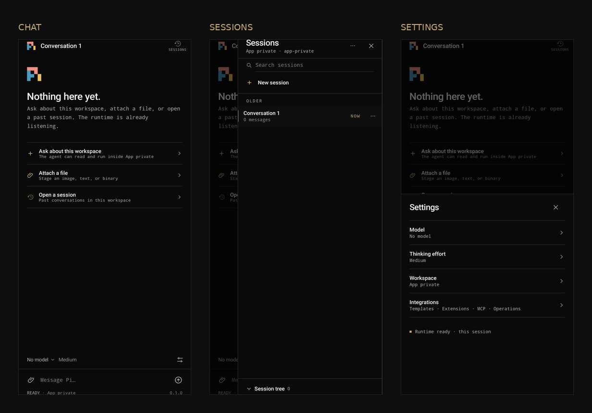
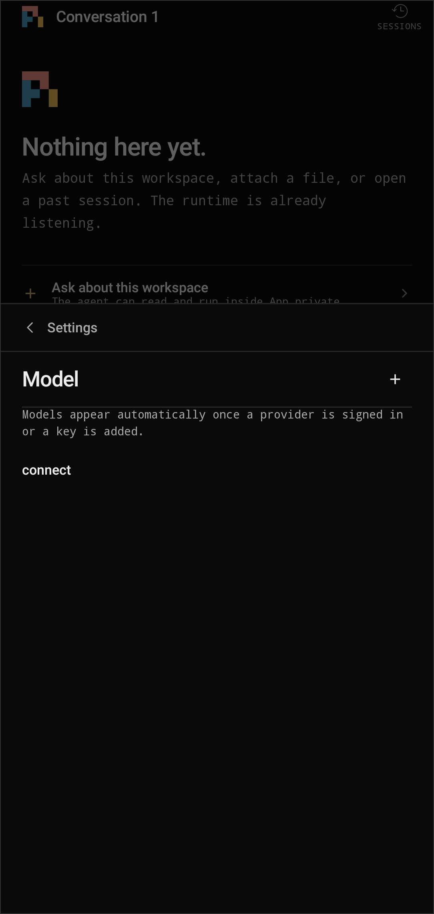
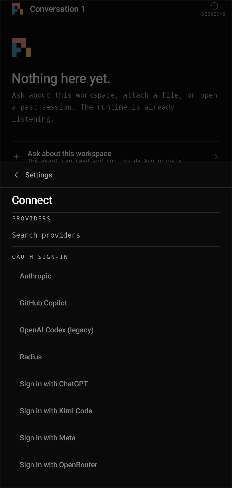

# Pi for Android

Pi Mobile is an actively developed Android client for Pi AI, built with Kotlin and Jetpack Compose. It runs Pi Durable in an app-owned WebView and delegates filesystem, shell, networking, and persistence work to Android-native adapters. The phone needs no separate Node.js installation or Linux userland.

> **[Get the latest APK](https://github.com/xzeronelysium/pi-mobile/releases/latest)** · [Architecture](docs/architecture.md) · [Markdown](docs/markdown.md) · [Contributing](CONTRIBUTING.md) · [Support](SUPPORT.md) · MIT licensed

## Features today

- **Chat and sessions** — start conversations, revisit session history, and work with session trees.
- **File-aware workspace** — attach files and use the app's Android workspace tools, plus a
  left-edge file drawer for browsing the bound workspace, previewing text, Markdown, code and
  images inline, and staging any file into the prompt.
- **Provider connections** — API-key setup and supported OAuth flows, depending on provider and device capabilities.
- **Android-native runtime** — Kotlin file and SQLite adapters, bounded shell execution and streaming through Android's `/system/bin/sh` (`mksh`), and provider networking.
- **Agent tools and integrations** — URL fetching, script execution, browser JavaScript packages in an isolated Worker, HTTP MCP, app resources, and durable workflows.

Capabilities vary by provider and environment. Consult the app's capability report and source; upstream Pi features are not automatically available on Android. This independent project is not affiliated with or endorsed by Pi, Nous Research, or connected providers.

## Architecture

```text
Jetpack Compose UI
        │ typed events / requests
        ▼
DurableRuntime → NativeRuntimeHost (app-owned WebView)
                         │
                    Pi Durable
                         │ AndroidNative bridge
              ┌──────────┼──────────┐
              ▼          ▼          ▼
       Kotlin file   /system/bin/sh  SQLite
          adapter      (mksh)       storage
```

Runtime source lives in `runtime/src`; esbuild generates the JavaScript asset at `app/src/main/assets/native-runtime/runtime.js`. No Node binary or separate shell is bundled. See [docs/architecture.md](docs/architecture.md) for component and security details.

## Screenshots

The overview uses real captures from the app running on a phone:

<p align="center">
  
</p>

<details>
  <summary>More screens: model setup and provider sign-in</summary>
  <p align="center">
    
    
  </p>
</details>

The screenshots show an empty demo conversation and no provider credentials. Status-bar details were cropped from the images.

## Download

Get the latest signed APK from [GitHub Releases](https://github.com/xzeronelysium/pi-mobile/releases/latest). Each release includes a SHA-256 checksum; verify it before installing. Keep the release signing keystore backed up securely so future updates remain installable.

> This is an early project under active development. Back up important workspace data and do not assume desktop Pi features are all available on Android.

## Build from source

### Requirements

- Android SDK with API 36 platform/build tools
- JDK 17
- Node.js 22+ and npm for runtime development and tests

Set `ANDROID_HOME` or add the SDK location in a local `local.properties` file (not committed).

```sh
# Android unit tests and debug APK (from repository root)
./gradlew :app:testDebugUnitTest
./gradlew :app:assembleDebug

# JavaScript runtime tests and bundle
cd runtime
npm ci
npm test
npm run build
```

The runtime build regenerates the asset under `app/src/main/assets/native-runtime/`. Commit the generated asset whenever runtime source or dependencies change. The runtime suite tests functionality and checks that the shipped bundle matches a fresh build. To test on a connected emulator or Android phone:

```sh
./gradlew :app:connectedDebugAndroidTest
```

### Signed release build

Gradle reads these environment variables for release signing: `ANDROID_KEYSTORE_FILE`, `ANDROID_KEY_ALIAS`, `ANDROID_KEYSTORE_PASSWORD`, and `ANDROID_KEY_PASSWORD`. Keep the keystore and passwords out of Git; do not put secrets directly in shell history. Once they are set securely:

```sh
./gradlew :app:assembleRelease
```

The APK is created at `app/build/outputs/apk/release/app-release.apk`. Update `versionName` and increment `versionCode` for each release. Follow [the release guide](docs/releasing.md), then verify the assets on GitHub. See [CHANGELOG.md](CHANGELOG.md) for release history.

## Security and permissions

- **Broad storage permission:** the app declares `MANAGE_EXTERNAL_STORAGE` for workspace access. This is sensitive and subject to Android/Google Play policy. Review it before granting access; Play distribution may require a policy-compliant alternative.
- **Shell is not a sandbox:** commands run through Android's `/system/bin/sh` using the app's UID. File tools apply workspace path rules, but those rules do not confine the shell process.
- **JavaScript packages are untrusted:** `js_run` executes package code in a separate WebView Worker without the Android bridge and exposes only declared input/output paths. This limits access; it does not make arbitrary packages trustworthy.
- **Credential handling:** provider credentials use Android Keystore-backed protection. Never commit credentials, signing keys, `local.properties`, or private user data.

See [NOTICE](NOTICE) for third-party notices and licensing. The project is available under the [MIT License](LICENSE). For questions, see [SUPPORT.md](SUPPORT.md); for private vulnerability reports, see [SECURITY.md](SECURITY.md).
